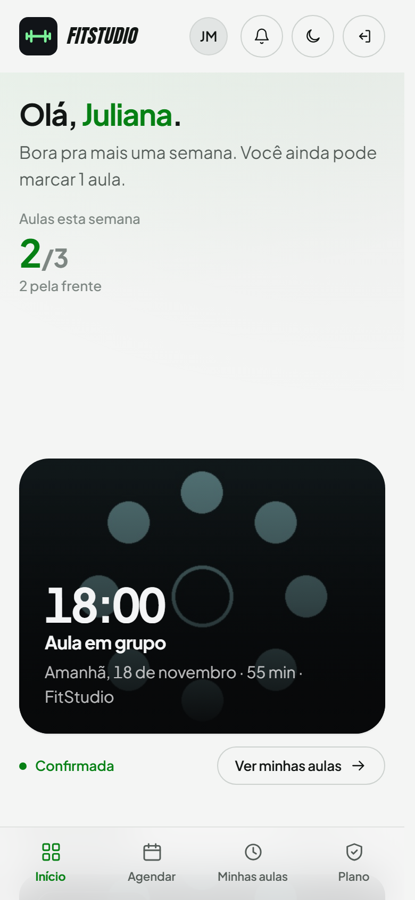
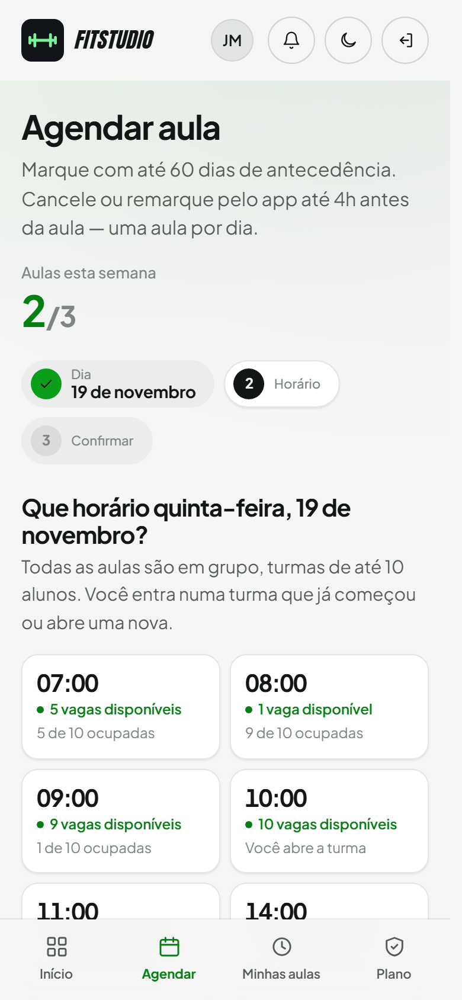
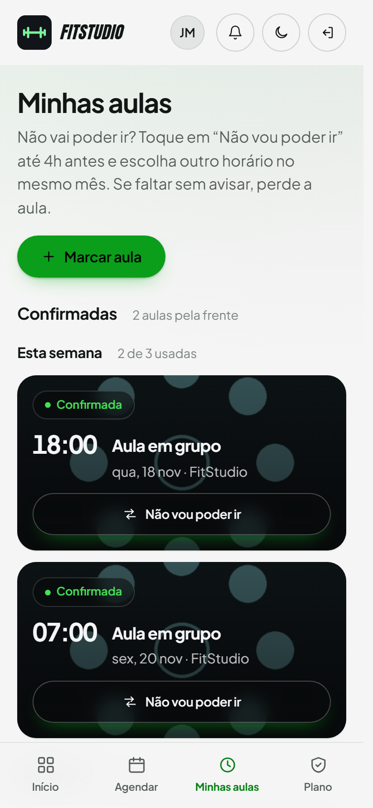
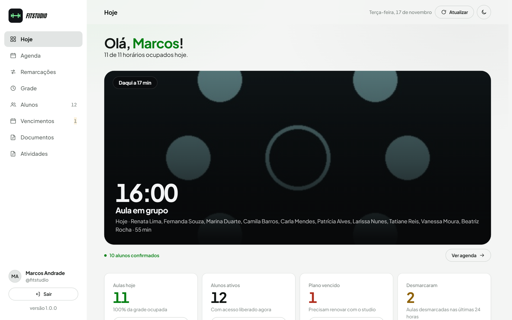
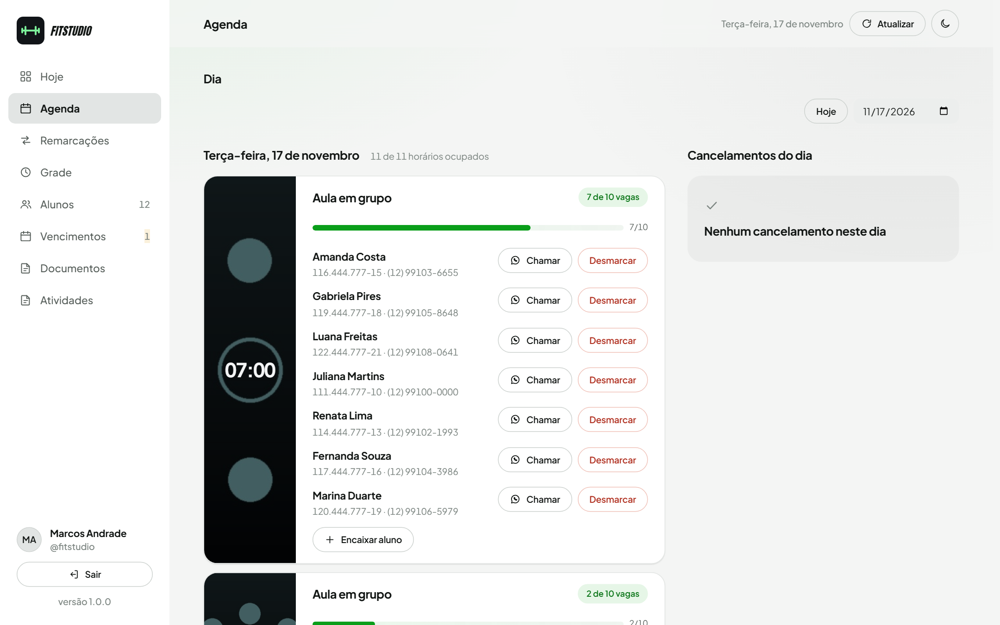
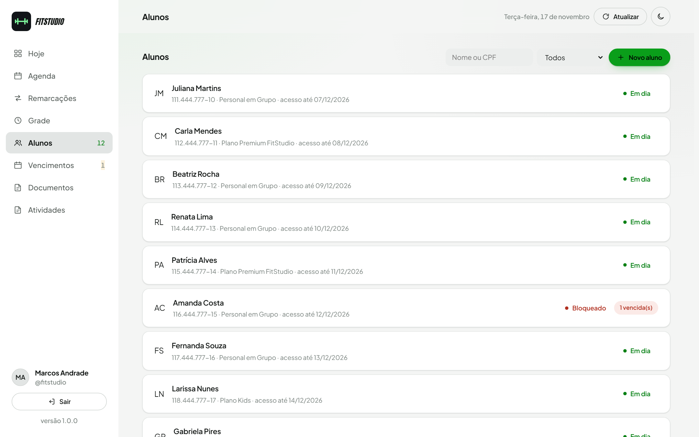
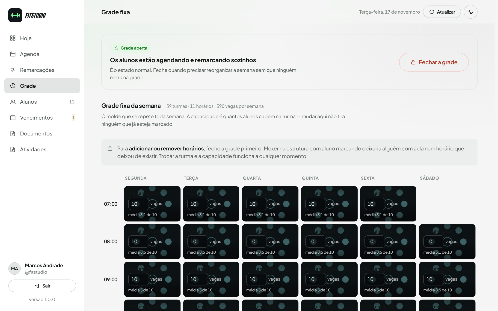
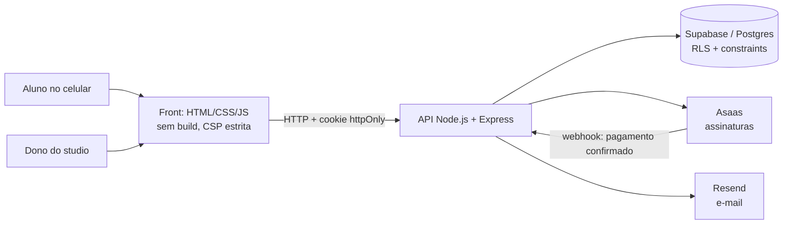

# FitStudio — plataforma de gestão para studios fitness

**Área do aluno + painel administrativo** para studios e academias pequenas que trabalham com aulas
em turma com vaga limitada. O aluno marca a própria aula vendo a vaga real e paga pelo app; o acesso
à agenda só é liberado quando o pagamento é confirmado. O dono acompanha o dia, os alunos e a
cobrança em um painel.

> Sistema que desenvolvi para um studio real e generalizei como produto. **Código-fonte privado**:
> esta página mostra o que ele faz. As telas usam marca, pessoas e dados fictícios.
> Acesso ao código para avaliação técnica sob solicitação.

  
  
  

## O problema

Em studio pequeno, agendamento e cobrança acontecem no WhatsApp: o professor confirma horário na
mão, lembra quem está devendo e libera quem pagou. O FitStudio tira isso do WhatsApp: o aluno agenda
sozinho em três passos e a cobrança recorrente libera o acesso automaticamente.

## Funcionalidades

**Área do aluno (pensada para o celular)**
- Login por CPF, cadastro e recuperação de senha por código enviado por e-mail
- Agenda com **vaga real por horário**, limite semanal conforme o plano e prazo para cancelar/remarcar
- Planos, checkout por Pix, boleto ou cartão e histórico de cobranças
- Resumo do mês: aulas concluídas, agendadas, canceladas e taxa de presença
- Contrato e política de privacidade aceitos no app (LGPD)

**Painel do studio**
- Visão do dia: próxima turma, quem confirmou, ocupação da grade e quem está com plano vencido
- Agenda por dia com os alunos de cada turma, encaixe e desmarcação
- Grade fixa da semana com capacidade por turma
- Alunos, liberação/bloqueio manual de acesso, congelamento de plano, inadimplência e log de ações

| Painel do studio | Agenda do dia |
|---|---|
|  |  |
| **Alunos** | **Grade fixa** |
|  |  |

## Arquitetura

- **Nada é decidido no navegador.** O status do plano é lido do banco a cada requisição: um aluno
  inadimplente perde o acesso na hora, sem esperar o token expirar.
- **Pagamento orientado a eventos:** o webhook do Asaas é a fonte da verdade, com idempotência por evento.
- **Sessão segura:** JWT curto em cookie httpOnly, refresh token rotativo guardado só como hash.
- **Concorrência no banco:** a disputa pela última vaga é resolvida por constraint no Postgres.

## Stack

`Node.js` · `Express` · `Supabase (Postgres)` · `Zod` · `JWT` · `bcrypt` · `Helmet` · `Asaas` ·
`Resend` · `HTML/CSS/JS (módulos ES)` · `Vercel` · `Docker` · `Caddy`

## O que eu aprendi

- Regra de negócio no servidor, sempre: autorização, limite semanal e vaga decididos no backend.
- Tratar webhook de pagamento como fonte da verdade, com idempotência e auditoria.
- Sessão segura na prática e tempo de resposta constante no login para não revelar se um CPF existe.
- Entregar para cliente real: LGPD, migrações versionadas e testes de ponta a ponta antes de mudar produção.

---

Feito por **Arthur Barreto** — estudante de Ciência da Computação (UFVJM) · [github.com/arthurbarreto07](https://github.com/arthurbarreto07)

© 2026 Arthur Barreto. Todos os direitos reservados.
